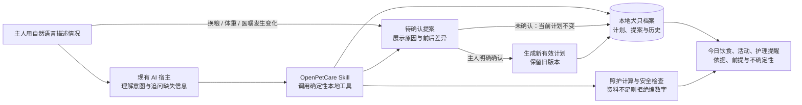

# OpenPetCare

> 让你已经在使用的 AI，获得一套可靠、可持续运行的个性化养狗能力。

OpenPetCare v0.1 是免费开源的犬只照护 Agent Skill。它不是另一个聊天机器人，而是一套可以被 Codex 等兼容 AI 调用的本地工具：保存每只狗的真实档案，根据资料和日期生成每日照护建议，并安全管理换粮、体重变化和兽医限制带来的计划调整。

它不是兽医诊断工具，也不提供打卡监督、后台推送、账号或云同步。

**代码免费开源；你使用的 Codex、Claude Code 或其他第三方 AI 服务可能收费或有额度限制。** 本项目不会为你支付宿主服务费用。

## 它能帮你做什么

| 你可以对 AI 说 | OpenPetCare 实际做什么 |
| --- | --- |
| “帮我建立一只狗的档案。” | 保存名称、年龄、体重、BCS、饮食、活动、病史和养护约束；不知道的内容保持未填写，不补造默认值。 |
| “它今天应该怎么吃、怎么运动？” | 重新计算当日年龄和适用条件；资料足够时给出可追溯的建议，资料不足时列出缺口，不编造精确克数或里程。 |
| “最近换了狗粮，需要调整吗？” | 比较新旧食物和喂养结果，先生成待确认提案，不立即覆盖当前方案。 |
| “确认更新这个方案。” | 只有明确确认后才写入新有效计划，并保留旧版本和变更历史。 |
| “最近不愿意散步，兽医要求限制活动。” | 优先应用健康风险和兽医限制；必要时暂停常规计算并提示联系兽医。 |
| “重新打开以后还能找到吗？” | 档案、有效计划和历史保存在系统持久数据目录，与 Skill 安装目录分离。 |

## 它如何工作



自然语言理解由用户选择的 AI 宿主完成；关键数据校验、照护计算、提案确认和持久化由 OpenPetCare 的本地程序执行。这样可以避免让模型临时心算关键数值或把含糊反馈直接写入有效计划。

## 平台兼容性

平台能力变化很快。以下结论是截至 **2026-10-31** 的核验状态；“官方结构兼容”不等于 OpenPetCare 已在该平台完成实机验收。

| 状态 | 平台 | 当前结论 |
| --- | --- | --- |
| 已完成代码级验证 | [Codex](https://learn.chatgpt.com/docs/build-skills) | 已验证本地 Skill 发现、独立安装包运行，以及建档、照护、提案、确认和新进程读回闭环；真实自然语言宿主会话仍需人工验收。 |
| 官方结构兼容，待实机 | [Claude Code](https://code.claude.com/docs/en/skills) | 仓库提供安装目标；尚未执行可能产生服务费用的完整 AI 调用和客户端重启验收。 |
| 官方结构兼容，待实机 | [Qwen Code](https://qwenlm.github.io/qwen-code-docs/en/users/features/skills/) | 官方支持 `SKILL.md`、辅助脚本，并读取 `~/.agents/skills/`；当前机器未安装 Qwen Code，不能标记为通过。 |
| 官方结构兼容，待实机 | [Qoder / Qoder CN](https://docs.qoder.cn/en/qoder/skills) | 官方支持导入 Skill 和本地工具执行；安装路径、权限与跨会话数据仍需单独验证。 |
| 官方结构兼容，待实机 | [腾讯 CodeBuddy](https://intl.cloud.tencent.com/ind/document/product/1316/84446) | 官方支持 `SKILL.md`、脚本和 Shell；尚未建立安装器适配或完成实机测试。 |
| 需要 MCP / 插件适配 | [豆包开放平台](https://open.doubao.com/) | 平台仍处于内测，并提供 Skill 及组合 Skill、MCP、CLI 的插件路线；普通豆包客户端不能直接安装当前本地包。 |
| 需要 MCP / 插件适配 | [扣子 / Coze](https://docs.coze.cn/mcp) | 可接入 Skill 或 MCP，但自定义 MCP 目前只支持 Streamable HTTP 和 SSE，不支持本地 STDIO；需要额外适配器。 |
| 需要 MCP / 插件适配 | [阿里云百炼](https://help.aliyun.com/zh/model-studio/official-and-third-party-mcp) | 智能体和工作流可调用 MCP；要保留 OpenPetCare 的数据边界，仍需设计部署、鉴权和持久化方案。 |

不能运行本地命令、不能保留持久文件、也没有插件或 MCP 工具能力的普通聊天客户端，当前无法使用完整的 OpenPetCare v0.1。豆包、扣子和百炼的适配属于后续候选方向，不会为了写入兼容列表而把首版改造成付费云服务。

## 运行要求

- Python 3.9 或更新版本；核心工具只使用标准库。
- 可在本机运行命令、保留本机文件的兼容 AI 客户端。云端临时沙箱的跨会话持久化未经验证。
- 首版仅支持犬。资料不足时会返回缺失项；不会凭体重单独编造主粮克数。

## 在 Codex 安装

在本仓库目录运行：

```bash
python3 scripts/install.py codex
```

这会把最小 Skill 包复制到 `~/.agents/skills/openpetcare`。安装后重新打开本地 Codex 会话，输入 `$openpetcare` 或在 `/skills` 中选择 OpenPetCare。也可在某个项目内安装：

```bash
python3 scripts/install.py codex --scope project --project /你的/项目目录
```

更新同一个普通目录安装时使用 `--replace`；安装脚本只替换 Skill 代码，不触碰犬只数据。若目标已经是符号链接，脚本会拒绝覆盖。

可先验证安装包中的工具：

```bash
python3 "$HOME/.agents/skills/openpetcare/scripts/opc.py" --help
python3 "$HOME/.agents/skills/openpetcare/scripts/opc.py" where
```

本机已验证 Codex CLI 能发现放在技能目录的 `SKILL.md`；**尚未把一次完整的自然语言建档、换粮和重启会话流程标为已通过宿主验收**。首次使用请观察 AI 是否确实调用了 `scripts/opc.py`，并检查命令输出。

## 亲自体验

在本地 Codex 中按顺序说：

1. “使用 `$openpetcare`，帮我建立一只狗的档案。”提供真实资料；不知道的字段直接说不知道。
2. “告诉我它今天应该怎么吃、怎么运动。”缺少包装热量、体况等资料时，Skill 应列出缺口；不会给主粮克数。
3. “我最近换了狗粮，需要调整吗？”提供新粮包装上的热量、完整均衡声明和适用生命阶段。AI 应先生成**待确认提案**并说明前后变化。
4. 检查提案后明确说“确认更新这个方案”。AI 才能执行确认并保存有效计划。
5. 关闭并重新打开本地客户端，再询问档案、今日照护和计划历史，核对仍可读取。

如需不依赖 AI 地检查工具，可运行 `python3 scripts/opc.py --help`。例如 `profile create --json '{"name":"小狗"}'` 仅建空白档案，其他未知字段会保存为 `null`。`profile list` 查看 ID，`daily --dog <UUID>` 查看程序的结构化结果。命令都可从已安装包的 `scripts/opc.py` 运行。

## 数据与隐私

真实档案不在仓库或 Skill 文件夹。默认位置：macOS `~/Library/Application Support/OpenPetCare`，Windows `%APPDATA%/OpenPetCare`，Linux `${XDG_DATA_HOME:-~/.local/share}/openpetcare`。`where` 命令可查看本机实际路径。每犬一份版本化、带 SHA-256 校验和的 JSON；写入时先写临时文件再原子替换。校验和能发现意外损坏，**不加密**。

`data backup` 在应用数据目录创建备份；`data export --path <路径>` 导出；`data import --path <路径>` 导入。已有同 ID 档案需显式加 `--replace`，此前应先备份当前数据。备份可能包含宠物健康及主人的时间、预算信息，不要提交到 Git 或公开传播。宿主 AI 在处理自然语言时可能接收相关档案内容；没有 OpenPetCare 云数据库不等于资料绝不会离开设备。

v0.1 采用单写入者模型：不要同时从多个终端或 AI 宿主修改同一只狗的档案；当前尚未实现跨进程文件锁。

## 科学与安全边界

在确认为健康、成年、BCS 4–5/9、主粮适龄且完整均衡等条件下，工具可依据 Merck 的维护能量公式提供**起始估算**，并与当前喂量比较；个体实际需求可能明显不同。若有兽医确认的日热量目标，会优先用该目标换算，但仍需确认食品和零食信息。其他情况不给精确克数。饮水始终应有清洁水可用；当前版本不给单一的毫升配额。运动建议不会编造固定里程或时长；有危险信号或兽医限制时按 [安全政策](docs/SAFETY_POLICY.md)处理。依据和适用地区见 [科学资料](docs/SCIENCE_SOURCES.md)。

## 其他本地 Skill 宿主

按 [Claude Code 官方 Skills 文档](https://code.claude.com/docs/en/skills)，可运行 `python3 scripts/install.py claude` 安装到 `~/.claude/skills/openpetcare`，并用 `/openpetcare` 调用。本机已确认安装了 Claude Code，但尚未运行可能产生服务费用的完整 AI 调用；其实际 Skill 发现、Python 执行与跨会话持久化仍待人工验证。

Qwen Code 官方会读取 `~/.agents/skills/`，因此 Codex 用户级安装所生成的目录结构也在其官方发现范围内；当前仍需在真实 Qwen Code 客户端验证调用与持久化。Qoder 和 CodeBuddy 使用各自的 Skill 目录，在提供一键安装前先按上方兼容矩阵看待，不手工声称已经支持。

## 项目文档与开发

从 [产品需求](docs/PRODUCT_SPEC.md)、[决策](docs/DECISIONS.md)、[架构](docs/ARCHITECTURE.md)、[数据结构](docs/DATA_SCHEMA.md)、[测试计划](docs/TEST_PLAN.md)和 [路线图](docs/ROADMAP.md)开始阅读。开发规则见 [AGENTS.md](AGENTS.md)。运行测试：

```bash
python3 -m unittest discover -s tests -v
```

许可证：[MIT](LICENSE)。引用的机构资料仍归原作者所有；仓库只列链接和简述，不转载受版权保护的图表或大段原文。
